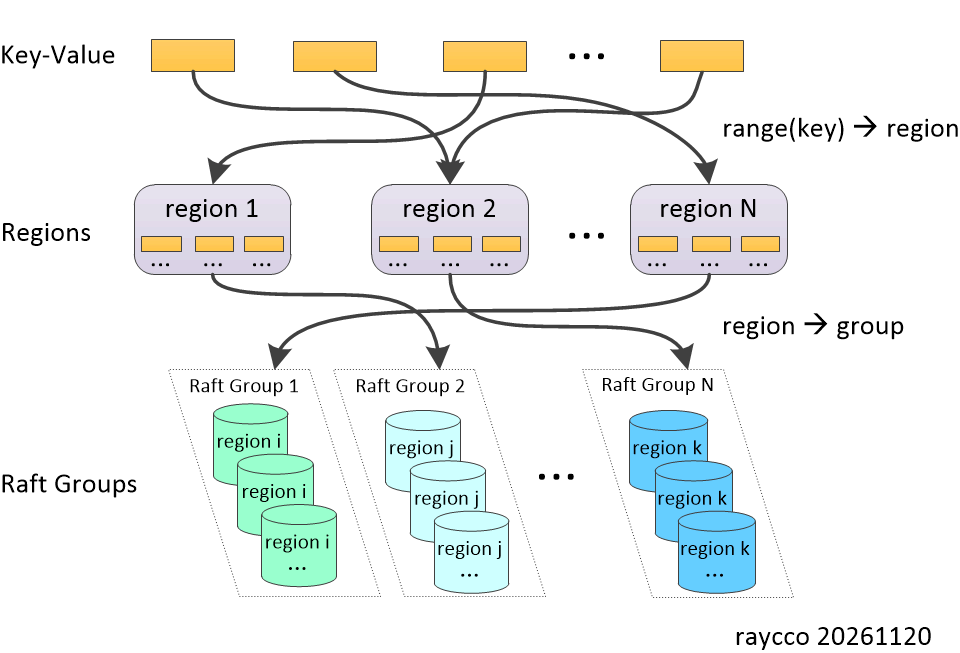
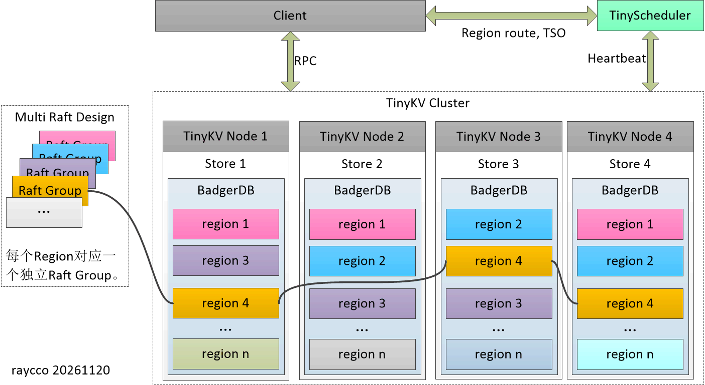
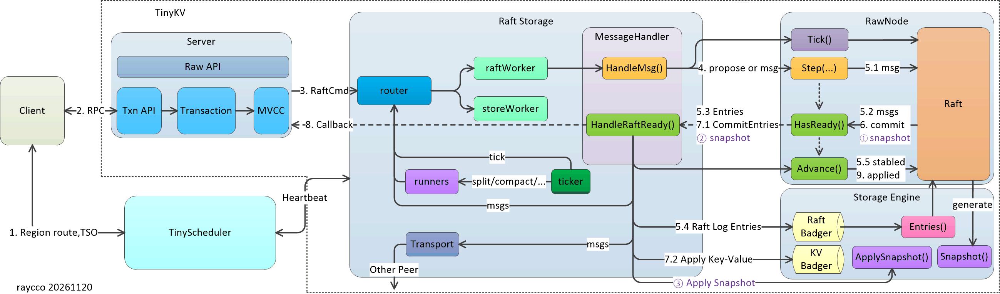

# The TinyKV Course

The TinyKV course builds a key-value storage system with the Raft consensus algorithm. It is inspired by [MIT 6.824](https://pdos.csail.mit.edu/6.824/) and [TiKV Project](https://github.com/tikv/tikv).

After completing this course, you will have the knowledge to implement a horizontally scalable, highly available, key-value storage service with distributed transaction support. Also, you will have a better understanding of TiKV architecture and implementation.

## Course Architecture

The whole project is a skeleton code for a key-value server and a scheduler server at the beginning - you need to finish the core logic step by step:

* [Standalone KV](doc/project1-StandaloneKV.md)
  * Implement a standalone storage engine.
  * Implement raw key-value service handlers.
* [Raft KV](doc/project2-RaftKV.md)
  * Implement the basic Raft algorithm.
  * Build a fault-tolerant KV server on top of Raft.
  * Add the support of Raft log garbage collection and snapshot.
* [Multi-raft KV](doc/project3-MultiRaftKV.md)
  * Implement membership change and leadership change to Raft algorithm.
  * Implement conf change and region split on Raft store.
  * Implement a basic scheduler.
* [Transaction](doc/project4-Transaction.md)
  * Implement the multi-version concurrency control layer.
  * Implement handlers of `KvGet`, `KvPrewrite`, and `KvCommit` requests.
  * Implement handlers of `KvScan`, `KvCheckTxnStatus`, `KvBatchRollback`, and `KvResolveLock` requests.

## Code Structure


Similar to the architecture of TiDB + TiKV + PD that separates the storage and computation, TinyKV only focuses on the storage layer of a distributed database system. If you are also interested in the SQL layer, please see [TinySQL](https://github.com/tidb-incubator/tinysql). Besides that, there is a component called TinyScheduler acting as a center control of the whole TinyKV cluster, which collects information from the heartbeats of TinyKV. After that, the TinyScheduler can generate scheduling tasks and distribute the tasks to the TinyKV instances. All of instances are communicated via RPC.

The whole project is organized into the following directories:

* `kv` contains the implementation of the key-value store.
* `raft` contains the implementation of the Raft consensus algorithm.
* `scheduler` contains the implementation of the TinyScheduler, which is responsible for managing TinyKV nodes and generating timestamps.
* `proto` contains the implementation of all communication between nodes and processes uses Protocol Buffers over gRPC. This package contains the protocol definitions used by TinyKV, and the generated Go code that you can use.
* `log` contains utility to output log based on level.

## Architecture
### 逻辑架构
TinyKV采用基于Key Range的分片 + Multi-Raft模型。
<div align="center">
    
</div>

- 客户端的 Key-Value 数据，按照 Key 的区间范围映射到对应的 Region；Region 是逻辑分片，负责管理一段连续 Key。
- 每一个 Region 独立绑定一个 Raft Group，Raft Group 包含多个副本 Peer，依靠 Raft 协议实现多副本一致性。
- Raft Group 负责 Region 分片的共识、日志同步与故障容错；后续可发生成员变更、Region Split、调度迁移等动态变更。

Region 是逻辑概念，将整个 Key-Value 空间分成很多段，每一段是一系列连续的 Key，将每一段叫做一个 Region，可以用 [StartKey，EndKey) 这样一个左闭右开区间来描述。

### 运行拓扑
<div align="center">
    
</div>

- 客户端 Client 先和 TinyScheduler 交互，获取 Region 路由信息、TSO 时间戳，之后直接通过 RPC 向对应的 TinyKV 节点发起读写请求。
- 集群由多个 TinyKV 节点（Node）组成，每个节点内包含一个 Store，底层依靠 BadgerDB 持久化保存业务数据与 Raft 日志。
- 同一个 Region 的多个副本分散部署在不同 TinyKV 节点上，由对应的 Raft Group 维护副本一致性，实现高可用。
- TinyScheduler 的组件，是整个 TinyKV 集群的控制中心。TinyKV 节点向 TinyScheduler 发送心跳，上报自身 Region 状态，支撑调度、路由更新、Region 迁移等管理动作。

### 关键流程
<div align="center">
    
</div>

*注：router 将消息发送给raftWorker处理，若 Peer 不存在，则会将消息发送给 storeWorker 处理，storeWorker 检查消息类型，若是选举消息或是 Commit = 0的心跳消息，则会创建 Peer。*

#### Client Request
1. 客户端 Client 先和 TinyScheduler 交互，获取 Region 路由信息、TSO 时间戳；
2. 客户端 Client 通过 RPC 向对应的 TinyKV 节点发起请求；
3. 请求经过 TinyKV Txn 事务层、MVCC 封装，封装为 RaftCmdRequest 发送给 router；
4. raftWorker 的 HandleMsg 统一处理本地 proposal 或者来自其他 Peer 的 Raft 消息；
5. 将本地 proposal 或者 msg 统一为 msg 调用 Step 传入 Raft；
     - Raft Leader 将数据转为日志 Entry 追加到日志，并发送日志复制消息给 Followers；
     - 上层循环调用 HasReady 拉取 Raft 输出的 Ready：待持久化 Raft 日志（Entries）、待发送 Raft 消息（msgs）；
     - 在HandleRaftReady 处理 Ready：持久化 Raft 日志到存储引擎，通过 Tansport 发送消息给 Raft Follower 节点；
     - 调用 Advance，推进 Raft 状态，更新持久化日志 Index；
     - Raft Leader 收到 Follower 多数派的回复，则达成一致 Commit；
6. 上层循环调用 HasReady 拉取 Raft 输出的 Ready，Ready 包含待持久化 Raft 日志/本地消息/跨节点消息/快照/已提交日志；
7. 在HandleRaftReady 处理 Ready：已提交日志 Apply 到状态机，将Key-Value写入存储引擎；
8. 同步写完成后通过回调 CallBack 回复客户端 Client；
9. 当 Ready 全部处理完成后调用 Advance，推进 Raft 状态，更新已提交日志 Index。

#### Split
1. Ticker 定时检测 Region 的状态，当一个其大小超过阈值时，生成 Task 由 runner 处理；
2. runner 生成 Split 任务封装成 RaftCmdRequest 发送给 router；
3. 经raftWorker 的 HandleMsg 处理，同样经过 Raft 协商达成一致后 Commit；
4. 在HandleRaftReady 处理 Ready：已提交日志 Apply 到状态机，执行 Region 分裂。
    - 检查 epoch 是否匹配，若不匹配返回 ErrEpochNotMatch 错误；
    - 检查 Key 是否在当前 Region 中，不在则返回 ErrKeyNotInRegion 错误；
    - 构造新 Region，新 Region 的 StartKey = SplitKey，旧 Region 的 EndKey = SplitKey，RegionEpoch 的 version 递增；
    - 在旧 Region 对应的 Stores 上创建 Raft Group Peers；
    - router 中注册 Peer，并且发送 MsgTypeStart 消息启动节点
    - 更新内存及 DB 中 Region 信息；
    - Leader 通过 Heartbeat 通知 Scheduler 刷新 Region 信息。

## Reading List

We provide a [reading list](doc/reading_list.md) for the knowledge of distributed storage system. Though not all of them are highly related with this course, they can help you construct the knowledge system in this field.

Also, you're encouraged to read the overview of TiKV's and PD's design to get a general impression on what you will build:

* TiKV, the design of data storage ([English](https://en.pingcap.com/blog/tidb-internal-data-storage), [Chinese](https://pingcap.com/zh/blog/tidb-internal-1)).
* PD, the design of scheduling ([English](https://en.pingcap.com/blog/tidb-internal-scheduling), [Chinese](https://pingcap.com/zh/blog/tidb-internal-3)).

## Build TinyKV from Source

### Prerequisites

* `git`: The source code of TinyKV is hosted on GitHub as a git repository. To work with git repository, please [install `git`](https://git-scm.com/downloads).
* `go`: TinyKV is a Go project. To build TinyKV from source, please [install `go`](https://golang.org/doc/install) with version greater or equal to 1.13.

### Clone

Clone the source code to your development machine.

```bash
git clone https://github.com/tidb-incubator/tinykv.git
```

### Build

Build TinyKV from the source code.

```bash
cd tinykv
make
```

It builds the binary of `tinykv-server` and `tinyscheduler-server` to `bin` dir.

## Run TinyKV with TinySQL

1. Get `tinysql-server` follow [its document](https://github.com/tidb-incubator/tinysql#deploy).
2. Put the binary of `tinyscheduler-server`, `tinykv-server` and `tinysql-server` into a single dir.
3. Under the binary dir, run the following commands:

```bash
mkdir -p data
./tinyscheduler-server
./tinykv-server -path=data
./tinysql-server --store=tikv --path="127.0.0.1:2379"
```

Now you can connect to the database with an official MySQL client:

```bash
mysql -u root -h 127.0.0.1 -P 4000
```
## Autograding and certification

Since Jun 2022, we start using [github classroom](https://github.com/talent-plan/tinysql/blob/course/classroom.md) to accept labs and provide autograding timely. The github classroom invitation is https://classroom.github.com/a/cdlNNrFU. The discussion Wechat/Slack group and the certification after you pass the class is provided in the [tinyKV learning class](https://talentplan.edu.pingcap.com/catalog/info/id:263)


Autograding is a workflow which can automatically run test cases and give feedback timely. However there are some limitations in Github classroom, in order to make golang work and run it in our self-hosted machines, **you need to overwrite the workflow generated by Github classroom and commit it**.

```sh
cp scripts/classroom.yml .github/workflows/classroom.yml
git add .github
git commit -m"update github classroom workflow"
```

## Contributing

Any feedback and contribution is greatly appreciated. Please see [issues](https://github.com/tidb-incubator/tinykv/issues) if you want to join in the development.
